<p align="center">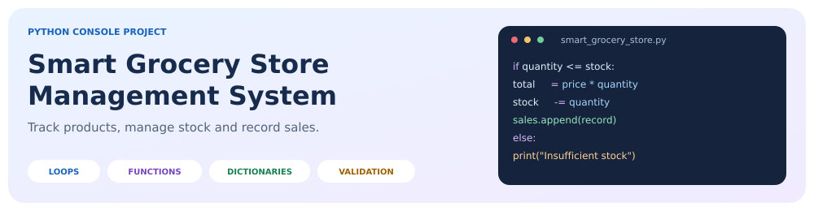</p>

## 1. Project Overview

A Python console application for managing products, inventory and single-product sales. This repository follows the uploaded `smart_grocery_store.py`: **four helper functions and eight branches inside a top-level menu loop**.

**Products and sales exist only for the current session. Closing or restarting clears all records.**

| Task / choice | Operation | File | Topic |
| --- | --- | --- | --- |
| 1 | Add New Product | `smart_grocery_store.py` | Dictionary creation + validation |
| 2 | View All Products | `smart_grocery_store.py` | Iteration + formatting |
| 3 | Search Product | `smart_grocery_store.py` | Exact linear search |
| 4 | Update Product Stock | `smart_grocery_store.py` | Conditional stock updates |
| 5 | Process Customer Sale | `smart_grocery_store.py` | Validation + arithmetic |
| 6 | View Sales Records | `smart_grocery_store.py` | Transaction traversal |
| 7 | Generate Store Report | `smart_grocery_store.py` | Loops + aggregation + comparisons |
| 8 | Exit | `smart_grocery_store.py` | Loop control |

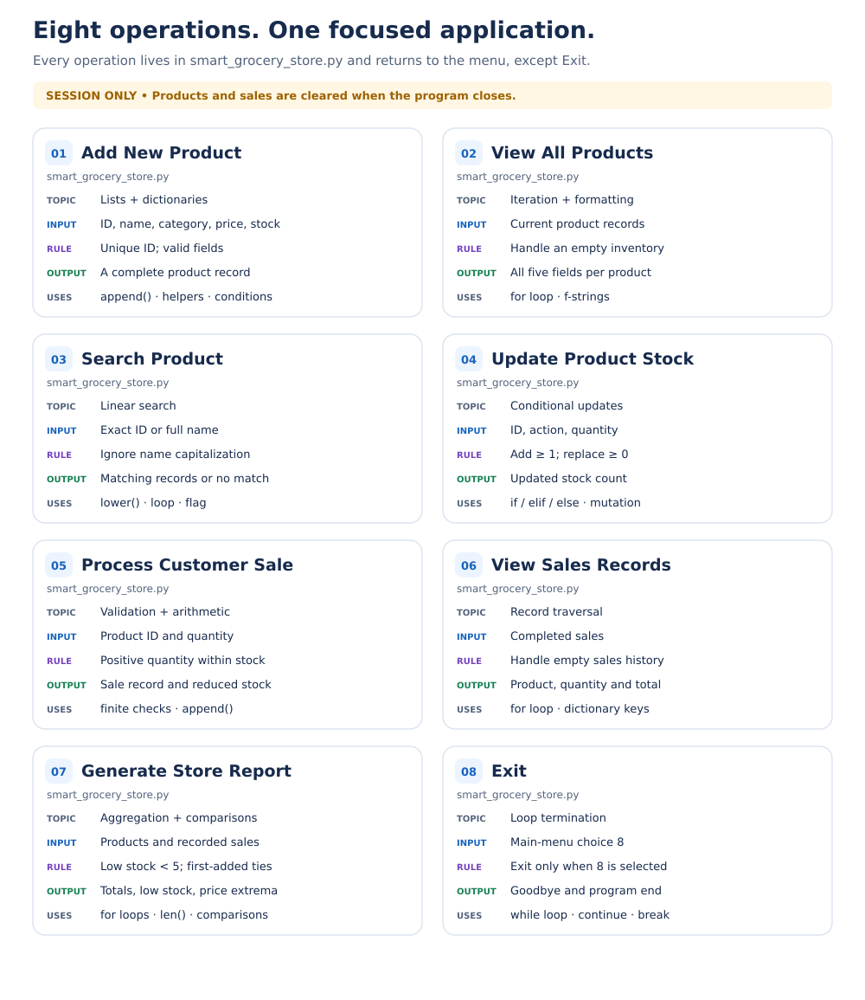

**Verified:** 82 tests passed on Python 3.12.14: 80 console scenarios and 2 subprocess checks. [Actual test log](tests/verification.txt) · [Recorded inputs, output and final records](tests/recorded_runs.json).

**Source and assumptions:** your uploaded Python file is the implementation reference. The assessment-brief field contains a placeholder, so no official rubric or required repository name was supplied. The folder name is assumed. Replace `YOUR_NAME` and `YOUR_USERNAME` before upload. [Full requirement review and changes](REQUIREMENTS.md).

**Small changes to your file:** added named constants, a numeric-input size check, and finite sale/revenue checks; corrected one comment indentation. The four helpers, inline menu structure, prompts and ordinary behaviour are retained. The ZIP includes your original file unchanged and a comparison patch outside the repository.

### Shared rules

| Field or behaviour | Actual rule |
| --- | --- |
| Product ID | Unique whole number of 1 or more. |
| Name / category | Both are read, trimmed and checked together; neither may be blank. |
| Price | Finite decimal ≥ 0, rounded and displayed to 2 decimal places. Signs, scientific notation, `nan` and `inf` are rejected. |
| Initial / replacement stock | Whole number ≥ 0. |
| Stock addition / purchase | Whole number ≥ 1; purchases must also be within stock. |
| Search | Exact stored ID as text or complete name using `.lower()`; no partial matching or leading-zero ID normalization. |
| Low stock | Strictly below `LOW_STOCK_THRESHOLD = 5`; includes 0, excludes 5. |
| Price ties | First-added matching product is retained. |
| Integer safety | At most 18 digits after stripping leading ASCII zeros; Unicode decimal digits remain supported through `isdecimal()`. |
| Sale safety | Reject non-finite transaction totals or accumulated revenue before changing stock or saving a sale. |

Prices retain the uploaded program's Python `float` storage. Two-decimal rounding/display is not exact-decimal accounting. No currency, tax, discount, basket or persistence requirements were supplied.

## 2. Folder Structure

```text
smart-grocery-store-management-system/
├── .github/
│   └── workflows/
│       └── tests.yml
├── assets/
│   ├── add_product_flow.png
│   ├── add_product_flow.svg
│   ├── banner.png
│   ├── banner.svg
│   ├── exit_flow.png
│   ├── exit_flow.svg
│   ├── generate_report_flow.png
│   ├── generate_report_flow.svg
│   ├── overview.png
│   ├── overview.svg
│   ├── process_sale_flow.png
│   ├── process_sale_flow.svg
│   ├── search_product_flow.png
│   ├── search_product_flow.svg
│   ├── uml_diagram.png
│   ├── uml_diagram.svg
│   ├── update_stock_flow.png
│   ├── update_stock_flow.svg
│   ├── view_products_flow.png
│   ├── view_products_flow.svg
│   ├── view_sales_flow.png
│   └── view_sales_flow.svg
├── tests/
│   ├── recorded_runs.json
│   ├── regression_evidence.json
│   ├── test_smart_grocery_store.py
│   └── verification.txt
├── .gitignore
├── README.md
├── REQUIREMENTS.md
└── smart_grocery_store.py
```

Added repository folders: `assets/` contains SVGs and their PNG renders; `tests/` contains executable checks and captured evidence; `.github/workflows/` contains CI. `REQUIREMENTS.md` records the requirements, assumptions and source changes.

Outside the repository, the ZIP contains `previews/README-light.html`, `previews/README-dark.html`, `source/smart_grocery_store_original.py`, `source/submission_changes.patch`, `UPLOAD_CHECKLIST.md` and `VERIFICATION.txt`. These companion files are not needed to run the application.

## 3.1. Task 1 — Add New Product

The `choice == "1"` branch collects five fields and appends one complete dictionary to `products`.

### Rules and requirements

- The ID must be unique and at least 1.
- Name and category must contain non-space text.
- Price and initial stock may be zero; stock must be a whole number.

### Program Flow

<details><summary>View the add new product flowchart</summary>

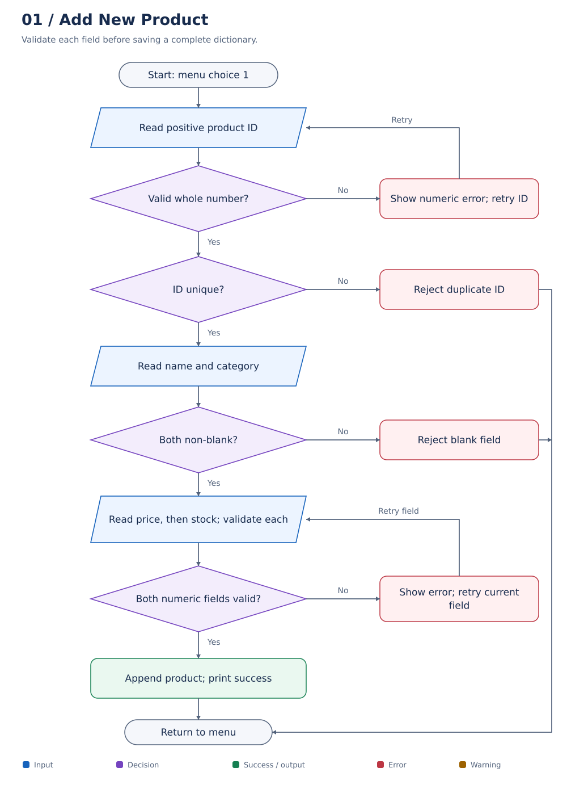

</details>

### Code Methods Description

| Method or section | Purpose |
| --- | --- |
| Menu branch `choice == "1"` | Checks duplicates, reads name/category, then appends the complete record. |
| `read_integer()` / `read_price()` | Repeat numeric prompts until valid values are entered. |
| `find_product()` | Returns an existing ID match or `None`. |

**Input Validation:** Both name and category are read before the combined blank-field check. A duplicate ID or blank text cancels registration; invalid numeric input repeats its prompt.

**Expected Results:** T02 saves Mango with ID 2, price 200.00 and stock 20. T03 rejects a duplicate without changing either existing product.

## 3.2. Task 2 — View All Products

The `choice == "2"` branch loops through every product and calls the shared display helper.

### Rules and requirements

- Keep the order in which products were added.
- Display prices to two decimal places and handle an empty inventory.

### Program Flow

<details><summary>View the view all products flowchart</summary>

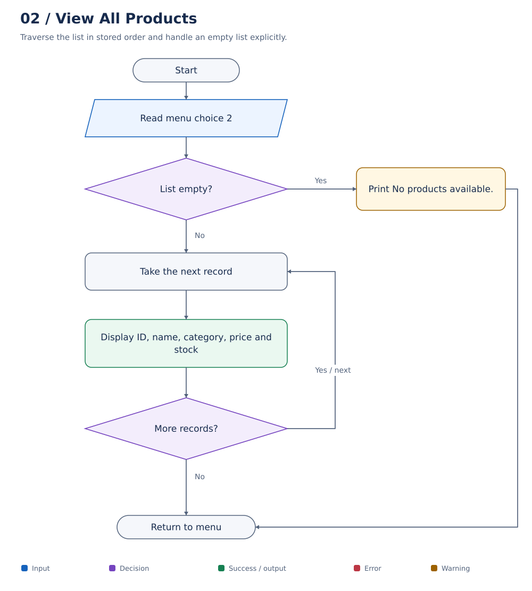

</details>

### Code Methods Description

| Method or section | Purpose |
| --- | --- |
| Menu branch `choice == "2"` | Handles an empty inventory and traverses `products`. |
| `display_product()` | Prints ID, name, category, a two-decimal price and stock. |

**Input Validation:** No additional input is needed after menu choice 2. An empty list prints `No products available.`.

**Expected Results:** T04 displays Mango and potato with their original stocks. T01 prints the empty-inventory message.

## 3.3. Task 3 — Search Product

The `choice == "3"` branch checks each record. IDs are compared as text; full names are compared with `.lower()`.

### Rules and requirements

- Use a complete name; partial names do not match.
- Display all matching records if different IDs share the same name.
- A missing product does not change any records.

### Program Flow

<details><summary>View the search product flowchart</summary>

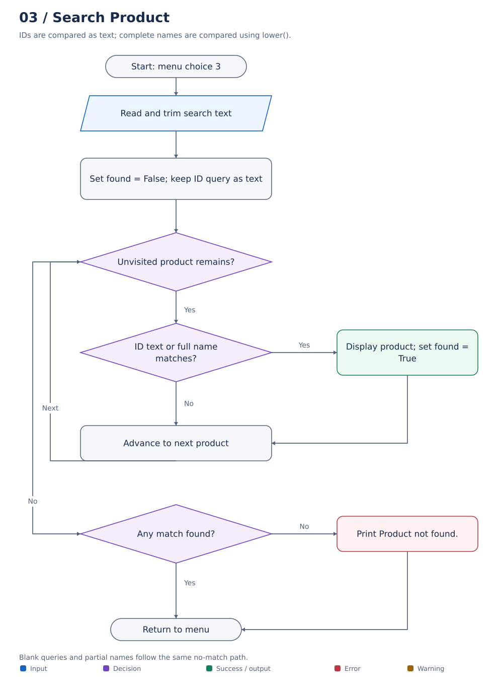

</details>

### Code Methods Description

| Method or section | Purpose |
| --- | --- |
| Menu branch `choice == "3"` | Uses a `found` flag and an exact ID/name comparison inside a `for` loop. |
| `display_product()` | Displays every matching record. |

**Input Validation:** A blank or partial-name query returns `Product not found.`. Searching `02` does not match stored ID `2`; `mAnGo` matches Mango. Search never changes records.

**Expected Results:** T06 finds Mango using `mAnGo`. T07 reports that ID 999 was not found. T43 displays both products named Mango.

## 3.4. Task 4 — Update Product Stock

The `choice == "4"` branch finds a product and either adds stock or sets a replacement count.

### Rules and requirements

- Action 1 adds a whole number of at least 1.
- Action 2 replaces stock with a whole number of at least 0.
- An unknown ID or invalid action leaves stock unchanged.

### Program Flow

<details><summary>View the update product stock flowchart</summary>

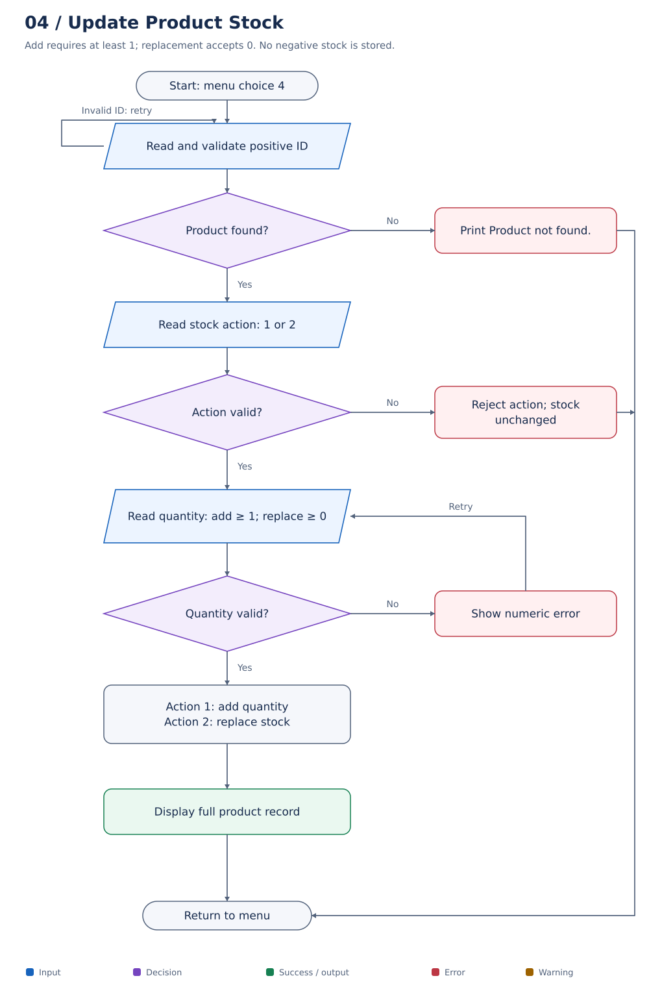

</details>

### Code Methods Description

| Method or section | Purpose |
| --- | --- |
| Menu branch `choice == "4"` | Chooses between adding stock and setting the available quantity. |
| `find_product()` / `read_integer()` | Resolve the ID and validate quantities. |
| `display_product()` | Prints the complete updated product. |

**Input Validation:** Invalid numeric input repeats. An absent ID prints `Product not found.`; an invalid stock action prints `Invalid choice.`. Both return to the main menu without changing stock.

**Expected Results:** T08 adds 5 mangoes, producing stock 25. T09 replaces potato stock with 3. T25 rejects action 9 without changing stock.

## 3.5. Task 5 — Process Customer Sale

The `choice == "5"` branch validates one product sale, calculates its total, reduces stock and appends one transaction.

### Rules and requirements

- The product must exist; quantity must be a whole number of at least 1.
- Quantity must not exceed available stock; selling exactly the available stock is allowed.
- Save the sale and reduce stock only after all checks pass.

### Program Flow

<details><summary>View the process customer sale flowchart</summary>

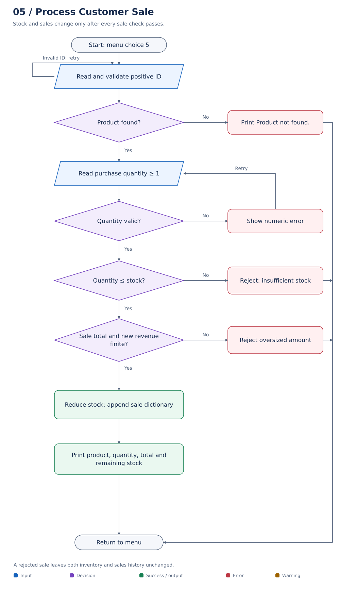

</details>

### Code Methods Description

| Method or section | Purpose |
| --- | --- |
| Menu branch `choice == "5"` | Checks quantity, stock and finite amounts before updating records. |
| `find_product()` / `read_integer()` | Find the product and validate numeric input. |
| `isfinite()` / `round()` | Check numeric range and round the transaction amount. |

**Input Validation:** Invalid numeric inputs repeat. Missing IDs, insufficient stock or an unrepresentable amount cancel the sale without changing stock or sales history.

**Expected Results:** T11 sells 3 potatoes for 450.00, leaves stock 6 and saves one transaction. T12 rejects quantity 10 and leaves stock 9.

## 3.6. Task 6 — View Sales Records

The `choice == "6"` branch loops over `sales` and prints ID, name, quantity sold and total amount.

### Rules and requirements

- Display completed transactions in their original order.
- Report an empty history clearly.
- Restocking does not rewrite a completed sale.

### Program Flow

<details><summary>View the view sales records flowchart</summary>

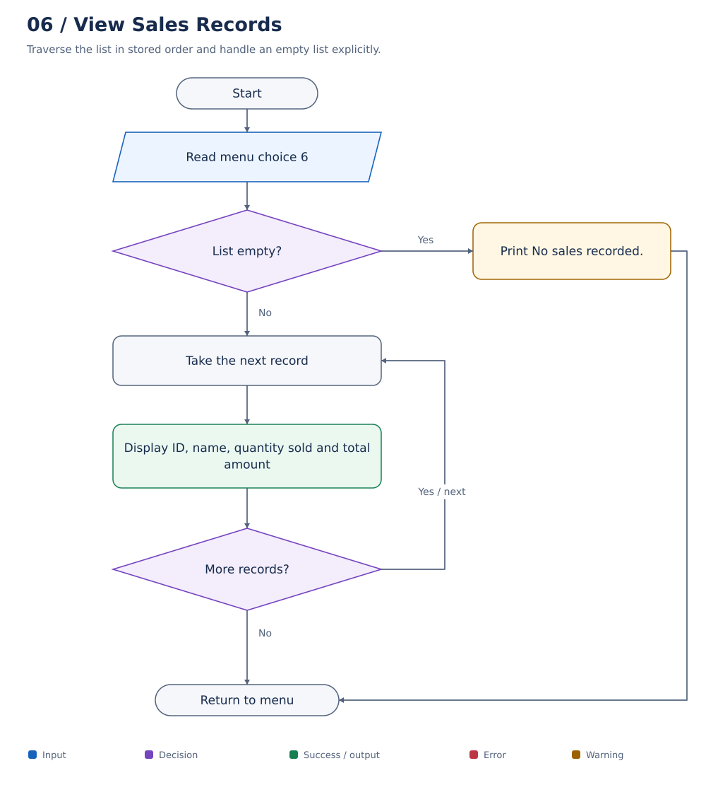

</details>

### Code Methods Description

| Method or section | Purpose |
| --- | --- |
| Menu branch `choice == "6"` | Handles empty history and prints each completed sale. |

**Input Validation:** No additional input is needed after choice 6. Only completed sales appear in the list.

**Expected Results:** T16 displays the 3-potato sale for 450.00. T15 prints `No sales recorded.`.

## 3.7. Task 7 — Generate Store Report

The `choice == "7"` branch uses explicit loops to total stock and revenue, then one product loop to find low stock and both price extrema.

### Rules and requirements

- Show total products, available stock, sales transactions and generated revenue.
- List products with stock strictly below 5, including 0; stock 5 is excluded.
- Show highest/lowest unit prices; a tie selects the first-added product; an empty inventory uses `N/A`.

### Program Flow

<details><summary>View the generate store report flowchart</summary>

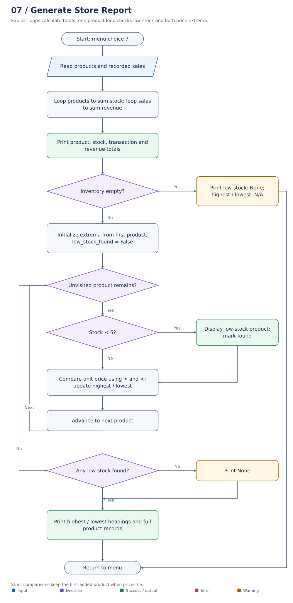

</details>

### Code Methods Description

| Method or section | Purpose |
| --- | --- |
| Stock and sales `for` loops | Accumulate `total_stock` and `total_revenue`. |
| Product report `for` loop | Lists stock below the threshold and updates highest/lowest unit prices. |
| `display_product()` | Prints full records for low-stock products and both price extrema. |

**Input Validation:** No extra input is required. An empty inventory prints zero totals, `Products below 5 units: None`, and `N/A` for highest/lowest prices. A populated report prints the heading and full record for each price extremum.

**Expected Results:** T17 reports 2 products, 26 units, 1 transaction and revenue 450.00. T19 includes stocks 0 and 4, and excludes stock 5.

## 3.8. Task 8 — Exit

The top-level `while True` loop repeats the menu; its `choice == "8"` branch prints `Goodbye!` and executes `break`.

### Rules and requirements

- Choices 1–7 run their matching operation and then show the menu again.
- Choice 8 prints `Goodbye!` and ends the program.
- Closing or restarting clears all session records.

### Program Flow

<details><summary>View the exit flowchart</summary>

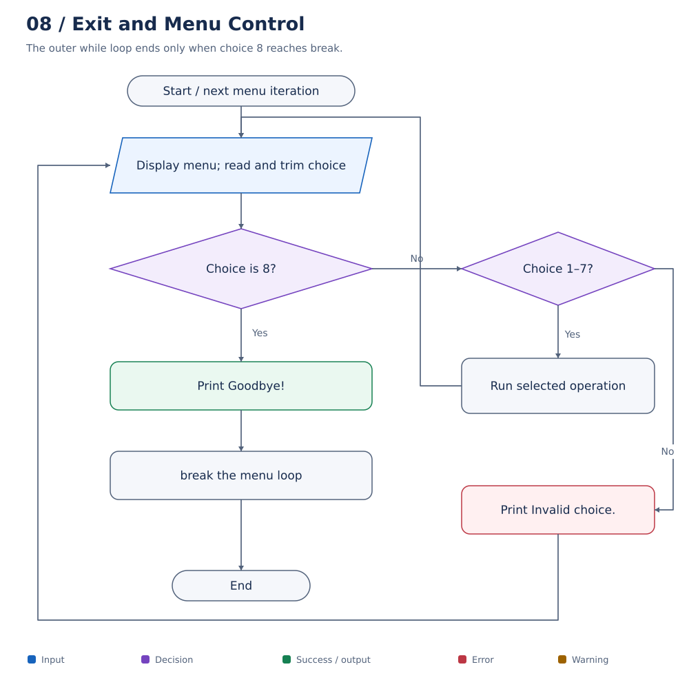

</details>

### Code Methods Description

| Method or section | Purpose |
| --- | --- |
| Top-level `while True` | Displays the menu and repeats after operations or rejected choices. |
| `continue` / `break` | Return early to the menu or end the application. |

**Input Validation:** Choices outside 1–8 print `Invalid choice. Enter a number from 1 to 8.`. Run the file directly: the menu executes at file scope, so importing it also starts the menu.

**Expected Results:** T29 prints Goodbye once and stops. T24 handles 0, 9 and abc. T30 and P02 verify a fresh session has no previous records.

## 4. UML Diagram

A **module diagram** fits this procedural program because it uses four functions, constants, shared lists and inline menu branches rather than application classes.

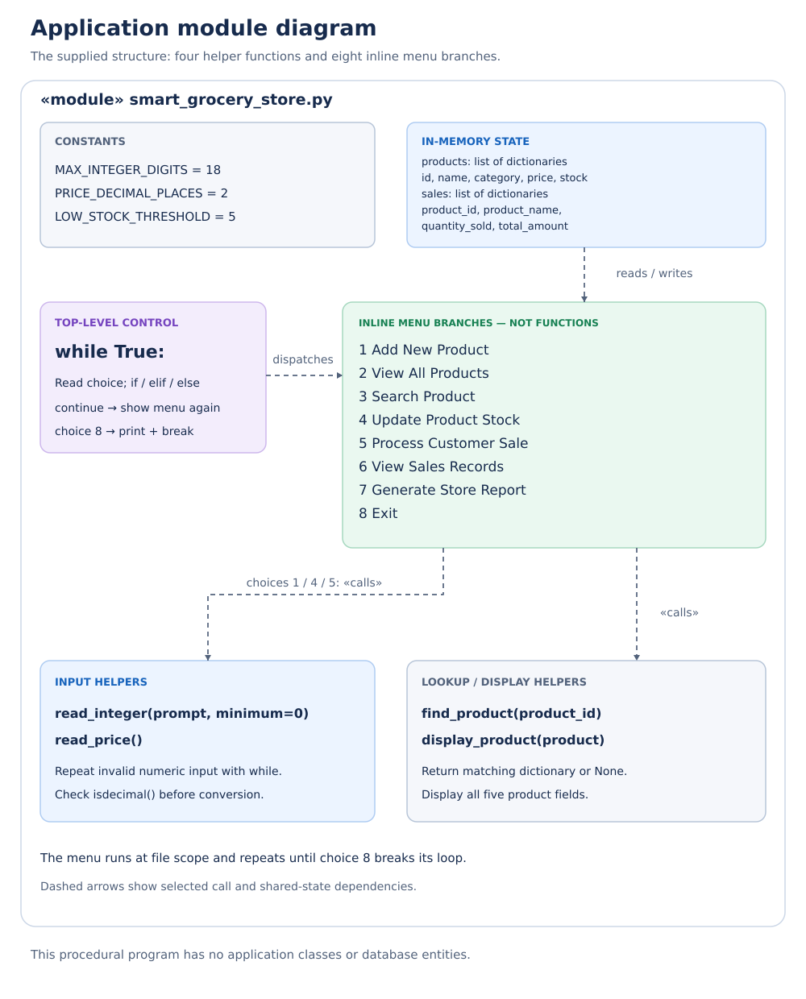

### The four helper functions

| Function | Purpose |
| --- | --- |
| `read_integer(prompt, minimum=0)` | Repeat input until a decimal whole number meets the minimum and size limit. |
| `read_price()` | Accept a finite non-negative decimal and round to two decimal places. |
| `find_product(product_id)` | Return a matching dictionary or `None`. |
| `display_product(product)` | Print all five product fields; show price with `.2f`. |

### Data model

```python
{"id": 2, "name": "Mango", "category": "Fruit", "price": 200.0, "stock": 20}
{"product_id": 4, "product_name": "potato", "quantity_sold": 3, "total_amount": 450.0}
```

The first record belongs to `products`; the second belongs to `sales`. One successful single-product purchase is one transaction. Product IDs are assigned values, not menu numbers.

## 5. Concepts and Techniques Used

- Lists of dictionaries, dictionary-key access and `.append()`.
- Four reusable helper functions, plus a top-level repeating menu.
- `while` for the menu and validation; `for` for lookup, display, totals and comparisons.
- `if` / `elif` / `else`, flags, `continue` and `break`.
- `strip()`, `isdecimal()`, `.lower()`, `str()` and two-decimal formatted strings.
- Named constants, `len()`, `round()` and the imported `isfinite()` function.
- Validation before conversion; no `try` / `except` blocks in the application.
- Scripted console scenarios, final-state assertions and genuine subprocess checks.

## 6. How to Run

**Requirements:** Python 3.10+ and a terminal. Git is needed only for cloning. The application and tests use the standard library; no external packages or `requirements.txt` are needed.

Replace `YOUR_USERNAME` with your GitHub username after creating the repository:

```bash
git clone https://github.com/YOUR_USERNAME/smart-grocery-store-management-system.git
cd smart-grocery-store-management-system
python smart_grocery_store.py
```

If you downloaded the ZIP, extract it and open a terminal in the repository folder before running the application.

| Environment | Run the application | Run the tests |
| --- | --- | --- |
| Python command | `python smart_grocery_store.py` | `python -m unittest discover -s tests -v` |
| macOS / Linux | `python3 smart_grocery_store.py` | `python3 -m unittest discover -s tests -v` |
| Windows launcher | `py -3 smart_grocery_store.py` | `py -3 -m unittest discover -s tests -v` |

Check syntax with `python -m py_compile smart_grocery_store.py tests/test_smart_grocery_store.py`. Choose 1–8, enter one value per prompt, and use 8 to exit. Run the script directly; importing it also enters the menu.

The GitHub Actions workflow is configured for Python 3.10, 3.12 and 3.13. Local verification used Python 3.12.14; the workflow has not been executed remotely.

## 7. Sample Execution

The excerpts below are copied from passing recorded runs. The test reader echoes entered values. Only repeated menus and baseline setup are omitted; program output is unchanged.

Each example starts independently. **Base inventory:** ID 2, Mango, Fruit, price 200.00, stock 20; and ID 4, potato, vegetable, price 150.00, stock 9.

<details><summary>Task 1: Add New Product — normal and rejection/edge examples</summary>

**Successful registration (T02)**

```text
Enter your choice: 1
Enter product ID: 2
Enter product name: Mango
Enter category: Fruit
Enter price: 200
Enter available stock: 20
Product added successfully.
```

**Duplicate rejected (T03)**

```text
Enter your choice: 1
Enter product ID: 2
This product ID already exists.
```

</details>

<details><summary>Task 2: View All Products — normal and rejection/edge examples</summary>

**Products available (T04)**

```text
Enter your choice: 2
ID: 2 | Name: Mango | Category: Fruit | Price: 200.00 | Stock: 20
ID: 4 | Name: potato | Category: vegetable | Price: 150.00 | Stock: 9
```

**Empty inventory (T01)**

```text
Enter your choice: 2
No products available.
```

</details>

<details><summary>Task 3: Search Product — normal and rejection/edge examples</summary>

**Name match (T06)**

```text
Enter your choice: 3
Enter product name or ID: mAnGo
ID: 2 | Name: Mango | Category: Fruit | Price: 200.00 | Stock: 20
```

**Missing ID (T07)**

```text
Enter your choice: 3
Enter product name or ID: 999
Product not found.
```

</details>

<details><summary>Task 4: Update Product Stock — normal and rejection/edge examples</summary>

**Restock (T08)**

```text
Enter your choice: 4
Enter product ID: 2
1. Add stock
2. Set available stock
Enter your choice: 1
Enter stock to add: 5
ID: 2 | Name: Mango | Category: Fruit | Price: 200.00 | Stock: 25
```

**Invalid action (T25)**

```text
Enter your choice: 4
Enter product ID: 2
1. Add stock
2. Set available stock
Enter your choice: 9
Invalid choice.
```

</details>

<details><summary>Task 5: Process Customer Sale — normal and rejection/edge examples</summary>

**Completed sale (T11)**

```text
Enter your choice: 5
Enter product ID: 4
Enter purchase quantity: 3
Product: potato | ID: 4
Quantity: 3 | Total: 450.00
Remaining stock: 6
```

**Insufficient stock (T12)**

```text
Enter your choice: 5
Enter product ID: 4
Enter purchase quantity: 10
Insufficient stock. Available: 9
```

</details>

<details><summary>Task 6: View Sales Records — normal and rejection/edge examples</summary>

**Recorded sale (T16)**

```text
Enter your choice: 6
ID: 4 | Name: potato | Quantity sold: 3 | Total amount: 450.00
```

**Empty history (T15)**

```text
Enter your choice: 6
No sales recorded.
```

</details>

<details><summary>Task 7: Generate Store Report — normal and rejection/edge examples</summary>

**Worked-example report (T17)**

```text
Enter your choice: 7

STORE REPORT
Total products: 2
Total available stock: 26
Total sales transactions: 1
Total revenue generated: 450.00

Products below 5 units:
None

Highest-priced product:
ID: 2 | Name: Mango | Category: Fruit | Price: 200.00 | Stock: 20
Lowest-priced product:
ID: 4 | Name: potato | Category: vegetable | Price: 150.00 | Stock: 6
```

**Empty report (T18)**

```text
Enter your choice: 7

STORE REPORT
Total products: 0
Total available stock: 0
Total sales transactions: 0
Total revenue generated: 0.00
Products below 5 units: None
Highest-priced product: N/A
Lowest-priced product: N/A
```

</details>

<details><summary>Task 8: Exit — normal and rejection/edge examples</summary>

**Exit (T29)**

```text
Enter your choice: 8
Goodbye!
```

**Invalid menu input (T24)**

```text
Enter your choice: 0
Invalid choice. Enter a number from 1 to 8.
```

</details>

## 8. Test Cases

**Result: 82/82 passed on 16 November 2026.** All 80 scenarios run the actual application file and check output and/or final records. P01 and P02 use separate Python processes. Syntax checks are performed separately.

Every T-number starts fresh. **Base** adds the two products above first; **Fresh** starts with empty lists. Inputs show menu choices and prompt values in order. A final `8` is appended to end each session and is omitted from the table. `<blank>` is empty input; `<spaces>` contains only whitespace. Long-number descriptions mean literal digits, not scientific notation.

T30 runs a populated session before checking a new empty one. Low-stock assertions inspect the low-stock section specifically, because highest/lowest records also appear elsewhere in the report. T01–T30 retain the original scenario set; T31–T80 extend it.

### Task 1 — Add New Product

| # | Scenario | Inputs | Expected result |
| --- | --- | --- | --- |
| T02 | Add a product | Fresh; `1 → 2 → Mango → Fruit → 200 → 20` | Mango saved: ID 2, price 200.00, stock 20. |
| T03 | Duplicate ID | Base; `1 → 2` | Duplicate rejected; two products remain. |
| T20 | Invalid IDs and initial stock | Fresh; `1 → abc → 2.5 → -1 → 0 → 2 → Mango → Fruit → 200 → -1 → x → 1.5 → 20` | Seven numeric errors; valid Mango saved with stock 20. |
| T21 | Invalid prices | Fresh; `1 → 2 → Mango → Fruit → -1 → abc → nan → inf → 1.2.3 → <blank> → 200 → 20` | Six price errors; price 200.00 accepted. |
| T22 | Zero price and stock | Fresh; `1 → 2 → Mango → Fruit → 0 → 0` | Zero price and zero stock accepted. |
| T23 | Blank product fields together | Fresh; `1 → 2 → <blank> → Fruit → 1 → 2 → Mango → <spaces>` | Both attempts rejected; no products saved. |
| T26 | Price rounding | Fresh; `1 → 2 → Mango → Fruit → 12.346 → 1 → 2` | Price stored and displayed as 12.35. |
| T31 | Minimum product ID | Fresh; `1 → 1 → Rice → Grain → 10 → 1` | ID 1 is accepted. |
| T37 | Spaces-only product name | Fresh; `1 → 2 → <spaces> → Fruit` | Name rejected; no record saved. |
| T38 | Empty category | Fresh; `1 → 2 → Mango → <blank>` | Category rejected; no record saved. |
| T48 | Leading decimal point | Fresh; `1 → 1 → Sample → Test → .50 → 1` | Price .50 is accepted as 0.50. |
| T49 | Trailing decimal point | Fresh; `1 → 1 → Sample → Test → 12. → 1` | Price 12. is accepted as 12.00. |
| T50 | Unicode decimal price | Fresh; `1 → 1 → Sample → Test → ١٢.٥٠ → 1` | Unicode decimal digits are accepted; price is 12.50. |
| T51 | Unicode integer digits | Fresh; `1 → ٢ → Mango → Fruit → 200 → ٢٠` | Unicode ID and stock are accepted as 2 and 20. |
| T52 | Oversized integer | Fresh; `1 → 19 nines → 2 → Mango → Fruit → 200 → 20` | 19 significant digits rejected; ID 2 accepted. |
| T53 | Leading zeros | Fresh; `1 → 25 leading zeros + 2 → Mango → Fruit → 200 → 00020` | Leading zeros normalize to ID 2 and stock 20. |
| T54 | Price overflow | Fresh; `1 → 2 → Mango → Fruit → 400 nines → 200 → 20` | Non-finite price rejected; 200 accepted. |
| T57 | Several invalid fields in one session | Fresh; `1 → abc → 0 → 3 → Rice → Grain → -1 → nan → 10 → -1 → x → 2 → 5 → 3 → 0 → bad → 2 → 7` | Six integer and two price errors; valid sale totals 20.00; stock 0. |
| T62 | Trim surrounding whitespace | Fresh; ` 1  →  2  →  Mango  →  Fruit  →  200  →  20 ` | Whitespace stripped; clean values saved. |
| T74 | Eighteen-digit integer boundary | Fresh; `1 → 999999999999999999 → Sample → Test → 10 → 1` | An 18-significant-digit ID is accepted. |
| T75 | Five-thousand-digit ID regression | Fresh; `1 → 5000 nines → 2 → Mango → Fruit → 200 → 20` | Oversized ID retries without crashing; ID 2 is saved. |
| T78 | Negative price alone | Fresh; `1 → 2 → Mango → Fruit → -1 → 200 → 20` | Negative price rejected once; 200.00 accepted. |
| T79 | Malformed decimal alone | Fresh; `1 → 2 → Mango → Fruit → 1.2.3 → 200 → 20` | Malformed decimal rejected once; 200.00 accepted. |
| T80 | Both text fields blank in one attempt | Fresh; `1 → 2 → <blank> → <spaces>` | One error rejects the incomplete product; no records saved. |

### Task 2 — View All Products

| # | Scenario | Inputs | Expected result |
| --- | --- | --- | --- |
| T01 | Empty inventory | Fresh; `2` | No products available. |
| T04 | View all products | Base; `2` | Both products display all five fields. |

### Task 3 — Search Product

| # | Scenario | Inputs | Expected result |
| --- | --- | --- | --- |
| T05 | Search by ID | Base; `3 → 2` | Mango details display. |
| T06 | Search by mixed-case name | Base; `3 → mAnGo` | Mango details display. |
| T07 | Missing search result | Base; `3 → 999` | Product not found. |
| T41 | Blank search | Base; `3 → <spaces>` | Blank search returns Product not found. |
| T42 | Partial name is not a match | Base; `3 → Man` | Product not found. |
| T43 | Duplicate names with distinct IDs | Base; `1 → 9 → Mango → Other → 10 → 1 → 3 → MANGO` | Both exact-name matches display. |
| T61 | Numeric full product name | Fresh; `1 → 7 → 123 → Test → 10 → 1 → 3 → 123` | Full name 123 finds product ID 7. |
| T65 | Multiword exact name | Fresh; `1 → 1 → Brown Rice → Dry Goods → 10 → 1 → 3 → brown rice` | Exact multiword name matches ignoring case. |
| T69 | Search in empty inventory | Fresh; `3 → Mango` | Product not found. |
| T71 | Leading-zero search is a different ID string | Base; `3 → 02` | Search 02 does not match stored ID 2. |
| T72 | Empty search query | Base; `3 → <blank>` | Empty query reports Product not found. |
| T73 | Name matching uses lower, not casefold | Fresh; `1 → 1 → Straße → Test → 10 → 1 → 3 → STRASSE` | STRASSE does not match Straße under lower(). |

### Task 4 — Update Product Stock

| # | Scenario | Inputs | Expected result |
| --- | --- | --- | --- |
| T08 | Add stock | Base; `4 → 2 → 1 → 5` | Mango stock becomes 25. |
| T09 | Replace stock | Base; `4 → 4 → 2 → 3` | Potato stock becomes 3. |
| T10 | Update unknown ID | Base; `4 → 1` | Product not found; stocks stay 20 and 9. |
| T25 | Invalid stock action | Base; `4 → 2 → 9` | Invalid action; both stocks unchanged. |
| T35 | Invalid stock additions | Base; `4 → 2 → 1 → 0 → -1 → abc → 1.5 → 1` | Four errors; only valid addition 1 changes stock to 21. |
| T36 | Invalid replacement counts | Base; `4 → 4 → 2 → -1 → abc → 1.5 → 0` | Three errors; valid replacement 0 is accepted. |
| T40 | Invalid ID during update | Base; `4 → 0 → x → 4 → 1 → 1` | Two ID errors; potato stock becomes 10. |
| T58 | Non-numeric stock action | Base; `4 → 2 → abc` | Action rejected; Mango stock remains 20. |
| T68 | Update in empty inventory | Fresh; `4 → 1` | Product not found; no products. |
| T77 | Zero stock addition alone | Base; `4 → 2 → 1 → 0 → 5` | Zero addition rejected once; valid addition 5 yields stock 25. |

### Task 5 — Process Customer Sale

| # | Scenario | Inputs | Expected result |
| --- | --- | --- | --- |
| T11 | Successful sale | Base; `5 → 4 → 3` | Total 450.00; potato stock 6; one sale. |
| T12 | Insufficient stock | Base; `5 → 4 → 10` | Sale rejected; stock 9; no sales. |
| T13 | Invalid sale quantities | Base; `5 → 4 → 0 → -2 → abc → 1` | Three errors; quantity 1 sells for 150.00. |
| T14 | Sale with unknown ID | Base; `5 → 1` | Product not found; no sale. |
| T32 | Sell all available stock | Base; `5 → 4 → 9 → 7` | Sale 1350.00 succeeds; stock becomes 0 and is low. |
| T33 | Zero-price sale | Fresh; `1 → 1 → Water → Drinks → 0 → 2 → 5 → 1 → 1` | One free sale recorded; stock 1; revenue 0.00. |
| T34 | Repeated sales | Base; `5 → 4 → 3 → 5 → 4 → 2 → 7` | Two sales; revenue 750.00; potato stock 4. |
| T39 | Invalid ID during sale | Base; `5 → 0 → abc → -1 → 4 → 1` | Three ID errors; valid potato sale records 150.00. |
| T55 | Sale amount overflow | Fresh; `1 → 1 → Large → Test → 1 followed by 308 zeros → 2 → 5 → 1 → 2` | Unrepresentable sale rejected; stock 2; no sales. |
| T56 | Accumulated revenue overflow | Fresh; `1 → 1 → Large → Test → 1 followed by 308 zeros → 2 → 5 → 1 → 1 → 5 → 1 → 1` | First sale succeeds; second rejected; stock 1; one finite sale. |
| T60 | Rejected sale after a successful sale | Base; `5 → 4 → 3 → 5 → 4 → 7` | First sale retained; second rejected; stock 6; revenue 450.00. |
| T67 | Sale in empty inventory | Fresh; `5 → 1` | Product not found; no sale. |
| T70 | Zero-stock sale | Fresh; `1 → 1 → Water → Drinks → 0 → 0 → 5 → 1 → 1` | Sale rejected even at zero price; stock remains 0. |
| T76 | Five-thousand-digit quantity regression | Base; `5 → 4 → 5000 nines → 1` | Oversized quantity retries; one potato sells for 150.00. |

### Task 6 — View Sales Records

| # | Scenario | Inputs | Expected result |
| --- | --- | --- | --- |
| T15 | Empty sales history | Fresh; `6` | No sales recorded. |
| T16 | View completed sales | Base; `5 → 4 → 3 → 6` | History shows ID 4, potato, quantity 3, total 450.00. |
| T63 | Sales history survives restocking | Base; `5 → 4 → 3 → 4 → 4 → 2 → 50 → 6` | History still shows quantity 3 and 450.00 after stock is set to 50. |

### Task 7 — Generate Store Report

| # | Scenario | Inputs | Expected result |
| --- | --- | --- | --- |
| T17 | Worked-example report | Base; `5 → 4 → 3 → 7` | 2 products; 26 units; 1 transaction; revenue 450.00. |
| T18 | Empty report | Fresh; `7` | Zero totals; no low stock; price extrema N/A. |
| T19 | Low-stock boundaries together | Base; `4 → 2 → 2 → 0 → 4 → 4 → 2 → 4 → 1 → 6 → Water → Drinks → 10 → 5 → 7` | Stocks 0 and 4 appear as low stock; stock 5 is excluded. |
| T27 | No low-stock products | Base; `7` | Low-stock section says None. |
| T28 | Equal product prices | Fresh; `1 → 2 → Mango → Fruit → 200 → 20 → 1 → 4 → potato → vegetable → 200 → 9 → 7` | First-added Mango is both highest and lowest. |
| T44 | Stock exactly five | Fresh; `1 → 1 → Boundary → Test → 10 → 5 → 7` | Stock 5 is not low. |
| T45 | Stock exactly four | Fresh; `1 → 1 → Boundary → Test → 10 → 4 → 7` | Stock 4 is listed as low. |
| T46 | Stock exactly zero | Fresh; `1 → 1 → Boundary → Test → 10 → 0 → 7` | Stock 0 is listed as low. |
| T47 | One-product extrema | Fresh; `1 → 2 → Mango → Fruit → 200 → 20 → 7` | Mango appears as both highest and lowest. |
| T64 | Report across different products | Base; `5 → 2 → 2 → 5 → 4 → 3 → 7` | 2 products; 24 units; 2 transactions; revenue 850.00. |

### Task 8 — Exit

| # | Scenario | Inputs | Expected result |
| --- | --- | --- | --- |
| T24 | Invalid menu choices | Fresh; `0 → 9 → abc` | Three invalid-choice messages; menu continues. |
| T29 | Exit | Fresh; `8 (exit)` | Goodbye prints once and the menu stops. |
| T30 | Restart clears records | Fresh; `Populated session → restart → 2 → 6` | Second session starts with empty products and sales. |
| T59 | Empty menu choice | Fresh; `<blank>` | Invalid choice shown once before exit. |
| T66 | Menu continues after report | Base; `7 → 2` | Report returns to the menu; inventory can still be viewed. |

### Subprocess checks

| # | Scenario | Inputs | Expected result |
| --- | --- | --- | --- |
| P01 | Fresh process exits | `8` | Menu and one `Goodbye!`; successful process exit. |
| P02 | Restart and disk isolation | First process: add base products, sell 3 potatoes, exit; second: `2 → 6 → 8` | Second process has empty products/sales; both exit successfully; no data files are created. |

The [test log](tests/verification.txt) records the actual result. [Recorded runs](tests/recorded_runs.json) contain exact inputs, captured output, final products/sales and the source hash. [Regression evidence](tests/regression_evidence.json) records the original long-integer crash and numeric overflows alongside the corrected results.

---

**Author:** Muhammad Adnan · https://github.com/muhammadadnancss1-ship-it
