<p align="center">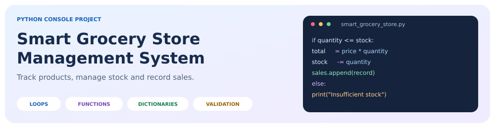</p>

## 1. Project Overview

A Python console application for a grocery store's products, inventory and single-product sales. It demonstrates lists of dictionaries, reusable functions, loops, conditions and validated input.

**Records are held in memory for one session. Closing or restarting clears all products and sales.**

| Task / choice | Operation | File | Main topic |
| --- | --- | --- | --- |
| 1 | Add New Product | `smart_grocery_store.py` | Dictionary creation and validation |
| 2 | View All Products | `smart_grocery_store.py` | Iteration and formatted output |
| 3 | Search Product | `smart_grocery_store.py` | Linear search and string comparison |
| 4 | Update Product Stock | `smart_grocery_store.py` | Conditional updates |
| 5 | Process Customer Sale | `smart_grocery_store.py` | Validation, arithmetic and state changes |
| 6 | View Sales Records | `smart_grocery_store.py` | List traversal |
| 7 | Generate Store Report | `smart_grocery_store.py` | Aggregation and comparisons |
| 8 | Exit | `smart_grocery_store.py` | Loop control |

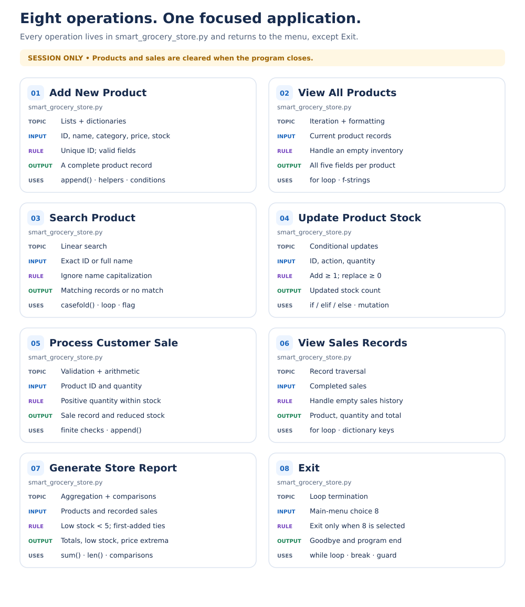

**Verified:** 72 tests passed on Python 3.12.14: 70 console scenarios and 2 process checks. See [captured runs](tests/recorded_runs.json) and the [test log](tests/verification.txt).

**Specification and assumptions:** the supplied README is the available specification; the assessment-brief field contains a placeholder. The folder name is assumed. Your name and GitHub username were not supplied, so replace `YOUR_NAME` and `YOUR_USERNAME` before uploading. No official grading criteria were supplied. [Complete requirements and assumptions](REQUIREMENTS.md).

All eight operations stay in the single application file specified by the source README. Added folders are `assets/` for diagrams and PNG copies, `tests/` for reproducible checks and evidence, and `.github/workflows/` for CI. `REQUIREMENTS.md` records the requirement review.

### Shared input and data rules

| Input / behaviour | Rule |
| --- | --- |
| Product ID | Unique whole number ≥ 1. |
| Name / category | Non-blank after trimming surrounding whitespace; internal wording is retained. |
| Price | Non-negative, finite decimal; rounded and displayed to two decimal places. Zero is valid. |
| Starting / replacement stock | Whole number ≥ 0. |
| Added / purchased quantity | Whole number ≥ 1; a purchase must also be within stock. |
| Search | Exact ID or complete name; name matching ignores capitalization. |
| Low stock | Strictly below `LOW_STOCK_THRESHOLD = 5`. |
| Price ties | First-added matching product is selected. |
| Numeric safety additions | ASCII digits; integer inputs have at most 18 significant digits. A leading/trailing decimal point is allowed for prices; exponent notation, signs, `nan`, `inf` and overflow are rejected. |
| Sale safety | A non-finite sale total or accumulated revenue is rejected before stock changes. |

Prices use Python `float`, as in the supplied specification. Rounding and two-decimal display do not provide exact decimal arithmetic. No currency, tax, discount or persistence rules were supplied, so none are assumed.

## 2. Folder Structure

```text
smart-grocery-store-management-system/
├── .github/
│   └── workflows/
│       └── tests.yml
├── assets/
│   ├── add_product_flow.png
│   ├── add_product_flow.svg
│   ├── banner.png
│   ├── banner.svg
│   ├── exit_flow.png
│   ├── exit_flow.svg
│   ├── generate_report_flow.png
│   ├── generate_report_flow.svg
│   ├── overview.png
│   ├── overview.svg
│   ├── process_sale_flow.png
│   ├── process_sale_flow.svg
│   ├── search_product_flow.png
│   ├── search_product_flow.svg
│   ├── uml_diagram.png
│   ├── uml_diagram.svg
│   ├── update_stock_flow.png
│   ├── update_stock_flow.svg
│   ├── view_products_flow.png
│   ├── view_products_flow.svg
│   ├── view_sales_flow.png
│   └── view_sales_flow.svg
├── tests/
│   ├── recorded_runs.json
│   ├── test_smart_grocery_store.py
│   └── verification.txt
├── .gitignore
├── README.md
├── REQUIREMENTS.md
└── smart_grocery_store.py
```

Each SVG has a PNG copy. The delivery ZIP also contains a `previews/` folder and an upload checklist **outside** this repository folder.

## 3.1. Task 1 — Add New Product

Collects five product fields and appends one complete dictionary to `products`.

### Rules and requirements

- The ID must be unique and at least 1.
- Name and category must contain non-space text.
- Price and initial stock may be zero; stock must be a whole number.

### Program Flow

<details><summary>View the add new product flowchart</summary>

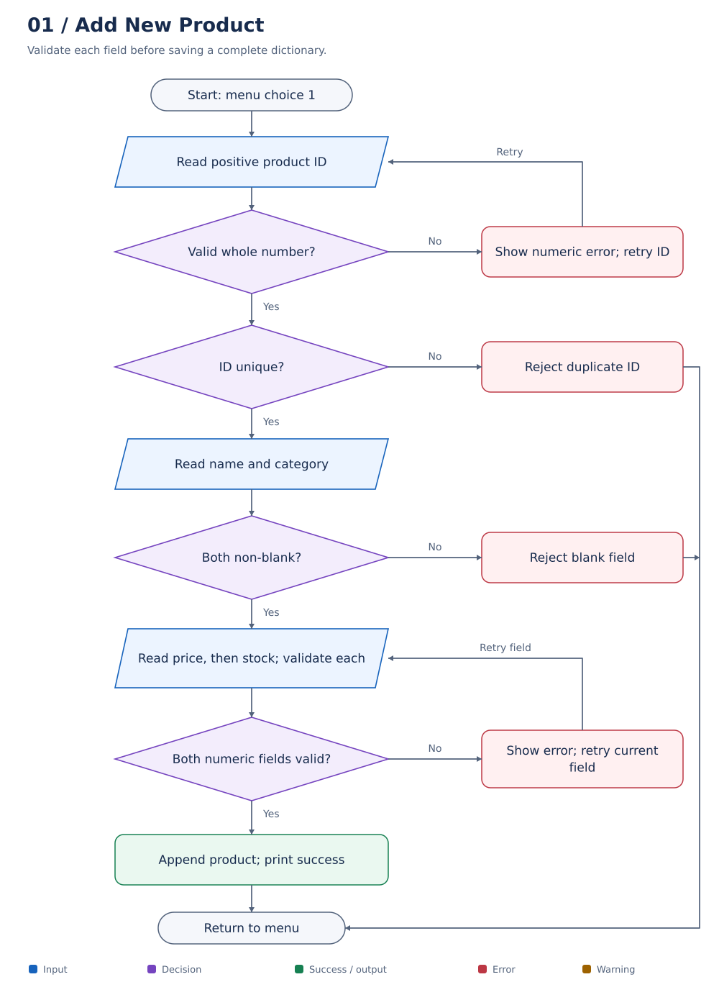

</details>

### Code Methods Description

| Method or section | Purpose |
| --- | --- |
| `add_product()` | Checks duplicates and blank fields; saves the validated record. |
| `read_integer()` / `read_price()` | Repeat invalid numeric prompts. |
| `find_product()` | Checks whether the ID already exists. |

**Input Validation:** Numeric errors repeat the current prompt. A duplicate ID or blank name/category cancels registration and returns to the menu.

**Expected Results:** T02 saves Mango with ID 2, price 200.00 and stock 20. T03 rejects a duplicate without changing either existing product.

## 3.2. Task 2 — View All Products

Traverses `products` with a `for` loop and prints all five fields for every record.

### Rules and requirements

- Keep the order in which products were added.
- Display prices to two decimal places and handle an empty inventory.

### Program Flow

<details><summary>View the view all products flowchart</summary>

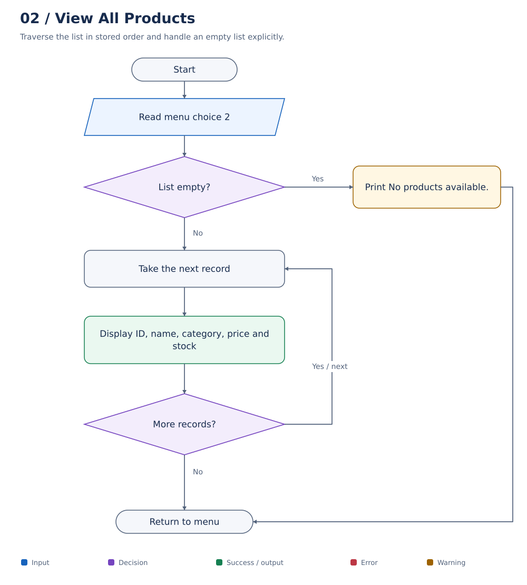

</details>

### Code Methods Description

| Method or section | Purpose |
| --- | --- |
| `view_products()` | Checks for an empty list, then traverses all records. |
| `display_product()` | Formats the ID, name, category, price and stock. |

**Input Validation:** No additional input is needed after menu choice 2. An empty list prints `No products available.`.

**Expected Results:** T04 displays Mango and potato with their original stocks. T01 prints the empty-inventory message.

## 3.3. Task 3 — Search Product

Performs a linear search by exact ID or exact full name. `casefold()` makes name matching ignore capitalization.

### Rules and requirements

- Use a complete name; partial names do not match.
- Display all matching records if different IDs share the same name.
- A missing product does not change any records.

### Program Flow

<details><summary>View the search product flowchart</summary>

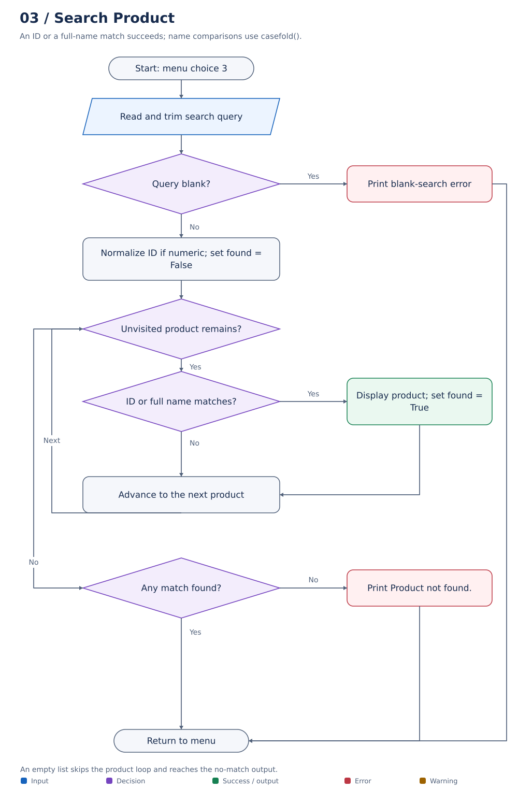

</details>

### Code Methods Description

| Method or section | Purpose |
| --- | --- |
| `search_product()` | Trims the query, checks each record and tracks whether a match was found. |
| `display_product()` | Prints each matching product. |

**Input Validation:** A blank query prints `Search cannot be blank.`. Non-matching text or an absent ID prints `Product not found.`.

**Expected Results:** T06 finds Mango using `mAnGo`. T07 reports that ID 999 was not found. T43 displays both products named Mango.

## 3.4. Task 4 — Update Product Stock

Finds one product, then adds to its stock or replaces its stock count using `if` / `elif` / `else`.

### Rules and requirements

- Action 1 adds a whole number of at least 1.
- Action 2 replaces stock with a whole number of at least 0.
- An unknown ID or invalid action leaves stock unchanged.

### Program Flow

<details><summary>View the update product stock flowchart</summary>

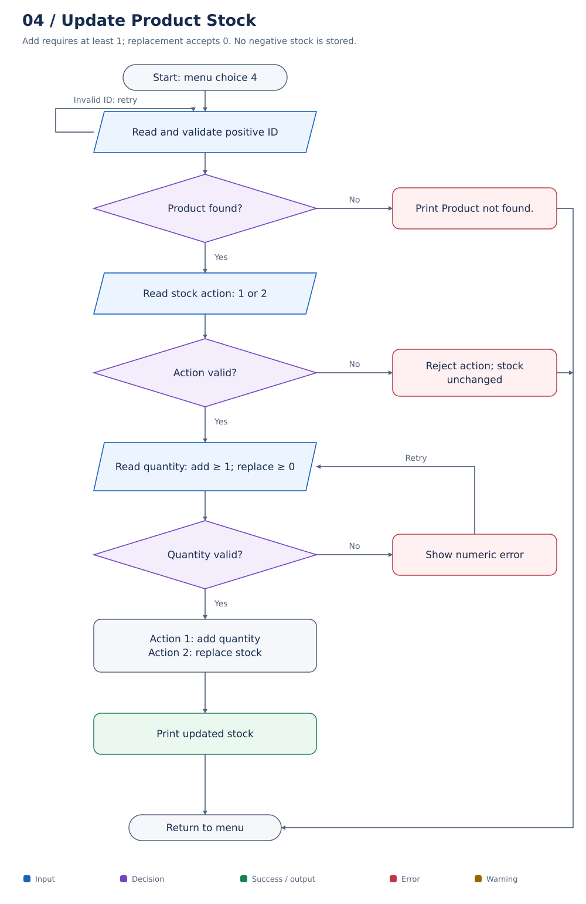

</details>

### Code Methods Description

| Method or section | Purpose |
| --- | --- |
| `update_stock()` | Selects the action, updates the dictionary and confirms the new stock. |
| `find_product()` / `read_integer()` | Find the record and validate its ID and quantity. |

**Input Validation:** Invalid numbers repeat their prompt. Invalid actions and unknown IDs return to the main menu.

**Expected Results:** T08 adds 5 mangoes, producing stock 25. T09 replaces potato stock with 3. T25 rejects action 9 without changing stock.

## 3.5. Task 5 — Process Customer Sale

Validates a single-product sale, calculates its total, reduces stock and appends one sale dictionary.

### Rules and requirements

- The product must exist; quantity must be a whole number of at least 1.
- Quantity must not exceed available stock; selling exactly the available stock is allowed.
- Save the sale and reduce stock only after all checks pass.

### Program Flow

<details><summary>View the process customer sale flowchart</summary>

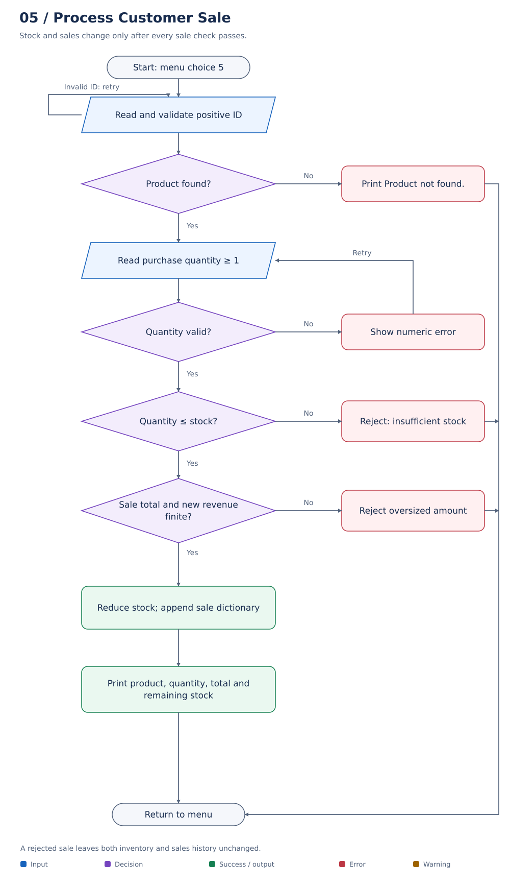

</details>

### Code Methods Description

| Method or section | Purpose |
| --- | --- |
| `process_sale()` | Checks availability and numeric range before changing either list. |
| `find_product()` / `read_integer()` | Resolve the product and validate numeric input. |
| `math.isfinite()` / `round()` | Reject overflow and round the transaction total to two decimals. |

**Input Validation:** Invalid numeric inputs repeat. Missing IDs, insufficient stock or an unrepresentable amount cancel the sale without changing stock or sales history.

**Expected Results:** T11 sells 3 potatoes for 450.00, leaves stock 6 and saves one transaction. T12 rejects quantity 10 and leaves stock 9.

## 3.6. Task 6 — View Sales Records

Traverses `sales` and prints the product ID, product name, quantity sold and transaction total.

### Rules and requirements

- Display completed transactions in their original order.
- Report an empty history clearly.
- Restocking does not rewrite a completed sale.

### Program Flow

<details><summary>View the view sales records flowchart</summary>

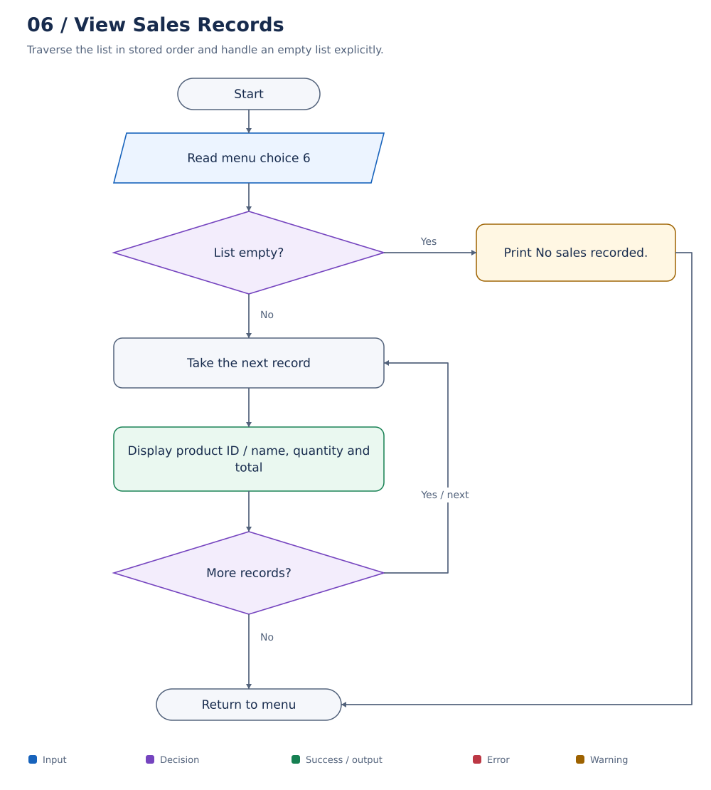

</details>

### Code Methods Description

| Method or section | Purpose |
| --- | --- |
| `view_sales()` | Checks for an empty history, then formats each stored transaction. |

**Input Validation:** No additional input is needed after choice 6. Only completed sales appear in the list.

**Expected Results:** T16 displays the 3-potato sale for 450.00. T15 prints `No sales recorded.`.

## 3.7. Task 7 — Generate Store Report

Aggregates the current records and compares unit prices using loops, `sum()`, `len()` and strict comparisons.

### Rules and requirements

- Show total products, available stock, sales transactions and generated revenue.
- List products with stock strictly below 5, including 0; stock 5 is excluded.
- Show highest/lowest unit prices; a tie selects the first-added product; an empty inventory uses `N/A`.

### Program Flow

<details><summary>View the generate store report flowchart</summary>

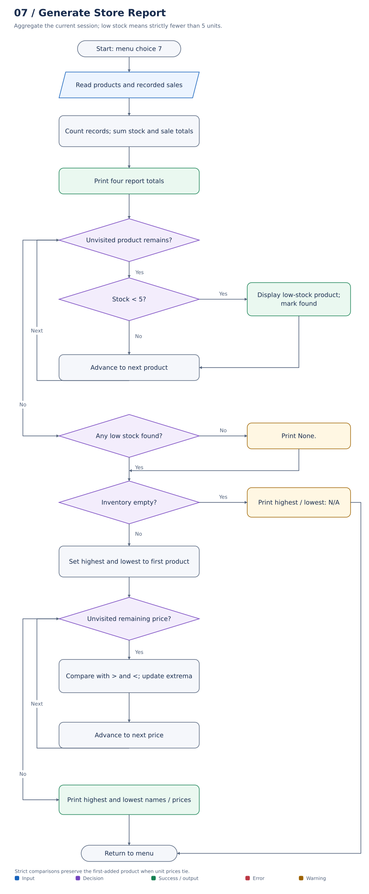

</details>

### Code Methods Description

| Method or section | Purpose |
| --- | --- |
| `generate_report()` | Calculates totals, lists low stock and selects price extrema. |
| `display_product()` | Prints each low-stock product. |
| `LOW_STOCK_THRESHOLD` | Keeps the low-stock rule in one named constant. |

**Input Validation:** The report accepts no additional input. Empty lists produce zero totals, `None.` for low stock and `N/A` for price extrema.

**Expected Results:** T17 reports 2 products, 26 units, 1 transaction and revenue 450.00. T19 includes stocks 0 and 4, and excludes stock 5.

## 3.8. Task 8 — Exit

Runs the repeating main menu and ends the `while` loop with `break` when the user chooses 8.

### Rules and requirements

- Choices 1–7 call their matching operation and then show the menu again.
- Choice 8 prints `Goodbye!` and ends the program.
- Closing or restarting clears all session records.

### Program Flow

<details><summary>View the exit flowchart</summary>

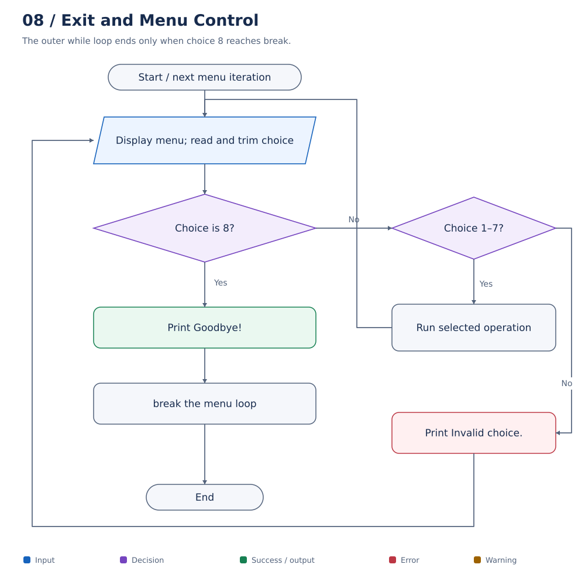

</details>

### Code Methods Description

| Method or section | Purpose |
| --- | --- |
| `main()` | Dispatches the eight choices and handles invalid menu input. |
| `if __name__ == "__main__":` | Starts the program when executed; importing does not open the menu. |

**Input Validation:** Any other menu value prints `Invalid choice. Enter a number from 1 to 8.` and repeats the menu.

**Expected Results:** T29 exits once. T24 handles 0, 9 and abc without stopping the menu. T30 and P02 verify that a new session has no previous records.

## 4. UML Diagram

A **module diagram** fits this procedural application because it uses functions, constants and shared record lists rather than application classes.

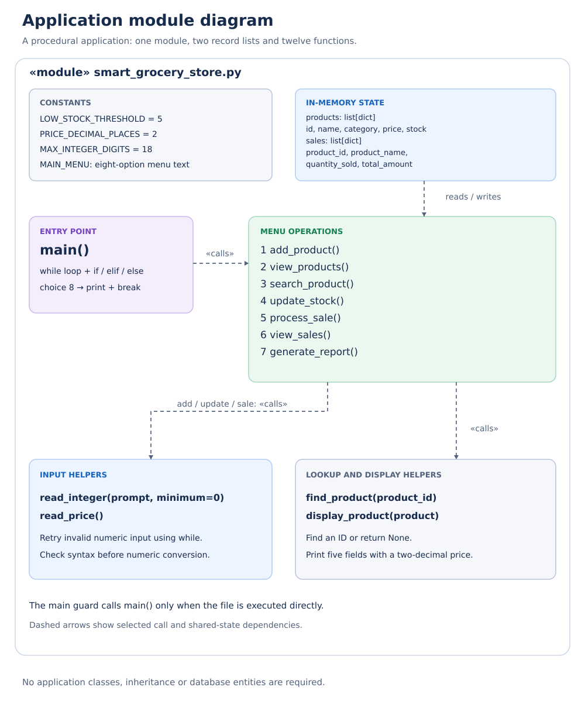

### Record structure

```python
{"id": 2, "name": "Mango", "category": "Fruit", "price": 200.0, "stock": 20}
{"product_id": 4, "product_name": "potato", "quantity_sold": 3, "total_amount": 450.0}
```

The first dictionary is stored in `products`; the second is stored in `sales`. A successful sale appends one transaction. The product ID identifies an inventory record; it is unrelated to menu-choice numbers.

## 5. Concepts and Techniques Used

- Lists of dictionaries and `.append()` for session records.
- Small reusable functions for input, lookup, display and menu operations.
- `while` loops for repeated prompts and the menu; `for` loops for search, display and reporting.
- `if` / `elif` / `else`, flags and early returns for clear decisions.
- Validation before conversion, with no `try` / `except` blocks in the application.
- `casefold()`, `strip()`, formatted strings, `sum()`, `len()`, `round()` and `math.isfinite()`.
- Named constants for the stock threshold, decimal places, numeric size and menu text.
- The main guard, standard-library tests, real input sequences and captured output.

## 6. How to Run

**Requirements:** Python 3.10+ and a terminal. Git is needed only for cloning. The application and tests use the standard library, so no package installation or `requirements.txt` is needed.

Replace `YOUR_USERNAME` below with your GitHub username after creating the repository:

```bash
git clone https://github.com/YOUR_USERNAME/smart-grocery-store-management-system.git
cd smart-grocery-store-management-system
python smart_grocery_store.py
```

After extracting the ZIP, you can instead open a terminal directly in the repository folder and run the final command above.

| Environment | Application command | Test command |
| --- | --- | --- |
| Python available as `python` | `python smart_grocery_store.py` | `python -m unittest discover -s tests -v` |
| macOS / Linux | `python3 smart_grocery_store.py` | `python3 -m unittest discover -s tests -v` |
| Windows launcher | `py -3 smart_grocery_store.py` | `py -3 -m unittest discover -s tests -v` |

Check syntax with `python -m py_compile smart_grocery_store.py tests/test_smart_grocery_store.py`. Choose an option, enter one value at each prompt, and select 8 to exit.

The included GitHub Actions workflow is configured to run syntax checks and tests on Python 3.10, 3.12 and 3.13 after upload. Local verification used Python 3.12.14; the remote workflow has not been run here.

## 7. Sample Execution

These excerpts are copied from the passing recorded runs. The test input reader echoes entered values. Repeated menus and baseline setup are omitted; program messages are unchanged.

The base inventory is Mango: ID 2, Fruit, price 200.00, stock 20; and potato: ID 4, vegetable, price 150.00, stock 9. Every example starts independently.

<details><summary>Task 1: Add New Product — normal and rejection/edge examples</summary>

**Successful registration (T02)**

```text
Enter your choice: 1
Enter product ID: 2
Enter product name: Mango
Enter product category: Fruit
Enter product price: 200
Enter available stock: 20
Product added successfully.
```

**Duplicate rejected (T03)**

```text
Enter your choice: 1
Enter product ID: 2
Product ID already exists. Product not added.
```

</details>

<details><summary>Task 2: View All Products — normal and rejection/edge examples</summary>

**Products available (T04)**

```text
Enter your choice: 2
--- Products ---
ID: 2 | Name: Mango | Category: Fruit | Price: 200.00 | Stock: 20
ID: 4 | Name: potato | Category: vegetable | Price: 150.00 | Stock: 9
```

**Empty inventory (T01)**

```text
Enter your choice: 2
No products available.
```

</details>

<details><summary>Task 3: Search Product — normal and rejection/edge examples</summary>

**Name match (T06)**

```text
Enter your choice: 3
Enter product ID or full name: mAnGo
ID: 2 | Name: Mango | Category: Fruit | Price: 200.00 | Stock: 20
```

**Missing ID (T07)**

```text
Enter your choice: 3
Enter product ID or full name: 999
Product not found.
```

</details>

<details><summary>Task 4: Update Product Stock — normal and rejection/edge examples</summary>

**Restock (T08)**

```text
Enter your choice: 4
Enter product ID: 2
1. Add stock
2. Replace stock
Choose stock action: 1
Enter quantity to add: 5
Stock updated. Mango: 25
```

**Invalid action (T25)**

```text
Enter your choice: 4
Enter product ID: 2
1. Add stock
2. Replace stock
Choose stock action: 9
Invalid stock action. Stock unchanged.
```

</details>

<details><summary>Task 5: Process Customer Sale — normal and rejection/edge examples</summary>

**Completed sale (T11)**

```text
Enter your choice: 5
Enter product ID: 4
Enter purchase quantity: 3
Sale completed.
Product: potato | ID: 4
Quantity: 3 | Total: 450.00
Remaining stock: 6
```

**Insufficient stock (T12)**

```text
Enter your choice: 5
Enter product ID: 4
Enter purchase quantity: 10
Insufficient stock. Available: 9. Sale not recorded.
```

</details>

<details><summary>Task 6: View Sales Records — normal and rejection/edge examples</summary>

**Recorded sale (T16)**

```text
Enter your choice: 6
--- Sales Records ---
Product ID: 4 | Product: potato | Quantity: 3 | Total: 450.00
```

**Empty history (T15)**

```text
Enter your choice: 6
No sales recorded.
```

</details>

<details><summary>Task 7: Generate Store Report — normal and rejection/edge examples</summary>

**Worked-example report (T17)**

```text
Enter your choice: 7
--- Store Report ---
Total products: 2
Total available stock: 26
Total sales transactions: 1
Total revenue generated: 450.00
Products below 5 units:
None.
Highest-priced product: Mango (200.00)
Lowest-priced product: potato (150.00)
```

**Empty report (T18)**

```text
Enter your choice: 7
--- Store Report ---
Total products: 0
Total available stock: 0
Total sales transactions: 0
Total revenue generated: 0.00
Products below 5 units:
None.
Highest-priced product: N/A
Lowest-priced product: N/A
```

</details>

<details><summary>Task 8: Exit — normal and rejection/edge examples</summary>

**Exit (T29)**

```text
Enter your choice: 8
Goodbye!
```

**Invalid menu input (T24)**

```text
Enter your choice: 0
Invalid choice. Enter a number from 1 to 8.
```

</details>

## 8. Test Cases

**Result: 72/72 passed on 16 November 2026.** Application syntax was checked separately. The suite asserts messages, final product fields, stocks, sale counts and totals; P02 uses genuine separate Python processes.

Every T-number starts with a fresh application. **Base** means the two original products above are added first; **Fresh** means empty products and sales. Input sequences show menu choices and prompt values in order. An exit value of `8` is appended automatically and omitted from the table. `<blank>` is empty input; `<spaces>` contains only whitespace. Long-number descriptions represent literal digits, not exponent notation.

T30 first runs a populated session and then checks a new empty session. The original 30 scenarios are retained as T01–T30; T31–T70 extend the checks.

### Task 1 — Add New Product

| # | Scenario | Inputs | Expected result |
| --- | --- | --- | --- |
| T02 | Add a product | Fresh; `1 → 2 → Mango → Fruit → 200 → 20` | Mango saved: ID 2, price 200.00, stock 20. |
| T03 | Duplicate ID | Base; `1 → 2` | Duplicate rejected; two products remain. |
| T20 | Invalid IDs and initial stock | Fresh; `1 → abc → 2.5 → -1 → 0 → 2 → Mango → Fruit → 200 → -1 → x → 1.5 → 20` | Seven numeric errors; valid Mango saved with stock 20. |
| T21 | Invalid prices | Fresh; `1 → 2 → Mango → Fruit → -1 → abc → nan → inf → 1.2.3 → <blank> → 200 → 20` | Six price errors; price 200.00 accepted. |
| T22 | Zero price and stock | Fresh; `1 → 2 → Mango → Fruit → 0 → 0` | Zero price and zero stock accepted. |
| T23 | Blank product fields together | Fresh; `1 → 2 → <blank> → 1 → 2 → Mango → <spaces>` | Both attempts rejected; no products saved. |
| T26 | Price rounding | Fresh; `1 → 2 → Mango → Fruit → 12.346 → 1 → 2` | Price stored and displayed as 12.35. |
| T31 | Minimum product ID | Fresh; `1 → 1 → Rice → Grain → 10 → 1` | ID 1 is accepted. |
| T37 | Spaces-only product name | Fresh; `1 → 2 → <spaces>` | Name rejected; no record saved. |
| T38 | Empty category | Fresh; `1 → 2 → Mango → <blank>` | Category rejected; no record saved. |
| T48 | Leading decimal point | Fresh; `1 → 1 → Sample → Test → .50 → 1` | Price .50 is accepted as 0.50. |
| T49 | Trailing decimal point | Fresh; `1 → 1 → Sample → Test → 12. → 1` | Price 12. is accepted as 12.00. |
| T50 | Non-ASCII prices | Fresh; `1 → 2 → Mango → Fruit → ١٢ → ² → １２ → 200 → 20` | Three non-ASCII prices rejected; 200 accepted. |
| T51 | Non-ASCII integer digits | Fresh; `1 → ٢ → ² → ２ → 2 → Mango → Fruit → 200 → 20` | Three non-ASCII IDs rejected; ID 2 accepted. |
| T52 | Oversized integer | Fresh; `1 → 19 nines → 2 → Mango → Fruit → 200 → 20` | 19 significant digits rejected; ID 2 accepted. |
| T53 | Leading zeros | Fresh; `1 → 25 leading zeros + 2 → Mango → Fruit → 200 → 00020` | Leading zeros normalize to ID 2 and stock 20. |
| T54 | Price overflow | Fresh; `1 → 2 → Mango → Fruit → 400 nines → 200 → 20` | Non-finite price rejected; 200 accepted. |
| T57 | Several invalid fields in one session | Fresh; `1 → abc → 0 → 3 → Rice → Grain → -1 → nan → 10 → -1 → x → 2 → 5 → 3 → 0 → bad → 2 → 7` | Six integer and two price errors; valid sale totals 20.00; stock 0. |
| T62 | Trim surrounding whitespace | Fresh; ` 1  →  2  →  Mango  →  Fruit  →  200  →  20 ` | Whitespace stripped; clean values saved. |

### Task 2 — View All Products

| # | Scenario | Inputs | Expected result |
| --- | --- | --- | --- |
| T01 | Empty inventory | Fresh; `2` | No products available. |
| T04 | View all products | Base; `2` | Both products display all five fields. |

### Task 3 — Search Product

| # | Scenario | Inputs | Expected result |
| --- | --- | --- | --- |
| T05 | Search by ID | Base; `3 → 2` | Mango details display. |
| T06 | Search by mixed-case name | Base; `3 → mAnGo` | Mango details display. |
| T07 | Missing search result | Base; `3 → 999` | Product not found. |
| T41 | Blank search | Base; `3 → <spaces>` | Search cannot be blank. |
| T42 | Partial name is not a match | Base; `3 → Man` | Product not found. |
| T43 | Duplicate names with distinct IDs | Base; `1 → 9 → Mango → Other → 10 → 1 → 3 → MANGO` | Both exact-name matches display. |
| T61 | Numeric full product name | Fresh; `1 → 7 → 123 → Test → 10 → 1 → 3 → 123` | Full name 123 finds product ID 7. |
| T65 | Multiword exact name | Fresh; `1 → 1 → Brown Rice → Dry Goods → 10 → 1 → 3 → brown rice` | Exact multiword name matches ignoring case. |
| T69 | Search in empty inventory | Fresh; `3 → Mango` | Product not found. |

### Task 4 — Update Product Stock

| # | Scenario | Inputs | Expected result |
| --- | --- | --- | --- |
| T08 | Add stock | Base; `4 → 2 → 1 → 5` | Mango stock becomes 25. |
| T09 | Replace stock | Base; `4 → 4 → 2 → 3` | Potato stock becomes 3. |
| T10 | Update unknown ID | Base; `4 → 1` | Product not found; stocks stay 20 and 9. |
| T25 | Invalid stock action | Base; `4 → 2 → 9` | Invalid action; both stocks unchanged. |
| T35 | Invalid stock additions | Base; `4 → 2 → 1 → 0 → -1 → abc → 1.5 → 1` | Four errors; only valid addition 1 changes stock to 21. |
| T36 | Invalid replacement counts | Base; `4 → 4 → 2 → -1 → abc → 1.5 → 0` | Three errors; valid replacement 0 is accepted. |
| T40 | Invalid ID during update | Base; `4 → 0 → x → 4 → 1 → 1` | Two ID errors; potato stock becomes 10. |
| T58 | Non-numeric stock action | Base; `4 → 2 → abc` | Action rejected; Mango stock remains 20. |
| T68 | Update in empty inventory | Fresh; `4 → 1` | Product not found; no products. |

### Task 5 — Process Customer Sale

| # | Scenario | Inputs | Expected result |
| --- | --- | --- | --- |
| T11 | Successful sale | Base; `5 → 4 → 3` | Total 450.00; potato stock 6; one sale. |
| T12 | Insufficient stock | Base; `5 → 4 → 10` | Sale rejected; stock 9; no sales. |
| T13 | Invalid sale quantities | Base; `5 → 4 → 0 → -2 → abc → 1` | Three errors; quantity 1 sells for 150.00. |
| T14 | Sale with unknown ID | Base; `5 → 1` | Product not found; no sale. |
| T32 | Sell all available stock | Base; `5 → 4 → 9 → 7` | Sale 1350.00 succeeds; stock becomes 0 and is low. |
| T33 | Zero-price sale | Fresh; `1 → 1 → Water → Drinks → 0 → 2 → 5 → 1 → 1` | One free sale recorded; stock 1; revenue 0.00. |
| T34 | Repeated sales | Base; `5 → 4 → 3 → 5 → 4 → 2 → 7` | Two sales; revenue 750.00; potato stock 4. |
| T39 | Invalid ID during sale | Base; `5 → 0 → abc → -1 → 4 → 1` | Three ID errors; valid potato sale records 150.00. |
| T55 | Sale amount overflow | Fresh; `1 → 1 → Large → Test → 1 followed by 308 zeros → 2 → 5 → 1 → 2` | Unrepresentable sale rejected; stock 2; no sales. |
| T56 | Accumulated revenue overflow | Fresh; `1 → 1 → Large → Test → 1 followed by 308 zeros → 2 → 5 → 1 → 1 → 5 → 1 → 1` | First sale succeeds; second rejected; stock 1; one finite sale. |
| T60 | Rejected sale after a successful sale | Base; `5 → 4 → 3 → 5 → 4 → 7` | First sale retained; second rejected; stock 6; revenue 450.00. |
| T67 | Sale in empty inventory | Fresh; `5 → 1` | Product not found; no sale. |
| T70 | Zero-stock sale | Fresh; `1 → 1 → Water → Drinks → 0 → 0 → 5 → 1 → 1` | Sale rejected even at zero price; stock remains 0. |

### Task 6 — View Sales Records

| # | Scenario | Inputs | Expected result |
| --- | --- | --- | --- |
| T15 | Empty sales history | Fresh; `6` | No sales recorded. |
| T16 | View completed sales | Base; `5 → 4 → 3 → 6` | History shows ID 4, potato, quantity 3, total 450.00. |
| T63 | Sales history survives restocking | Base; `5 → 4 → 3 → 4 → 4 → 2 → 50 → 6` | History still shows quantity 3 and 450.00 after stock is set to 50. |

### Task 7 — Generate Store Report

| # | Scenario | Inputs | Expected result |
| --- | --- | --- | --- |
| T17 | Worked-example report | Base; `5 → 4 → 3 → 7` | 2 products; 26 units; 1 transaction; revenue 450.00. |
| T18 | Empty report | Fresh; `7` | Zero totals; no low stock; price extrema N/A. |
| T19 | Low-stock boundaries together | Base; `4 → 2 → 2 → 0 → 4 → 4 → 2 → 4 → 1 → 6 → Water → Drinks → 10 → 5 → 7` | Stocks 0 and 4 appear as low stock; stock 5 is excluded. |
| T27 | No low-stock products | Base; `7` | Low-stock section says None. |
| T28 | Equal product prices | Fresh; `1 → 2 → Mango → Fruit → 200 → 20 → 1 → 4 → potato → vegetable → 200 → 9 → 7` | First-added Mango is both highest and lowest. |
| T44 | Stock exactly five | Fresh; `1 → 1 → Boundary → Test → 10 → 5 → 7` | Stock 5 is not low. |
| T45 | Stock exactly four | Fresh; `1 → 1 → Boundary → Test → 10 → 4 → 7` | Stock 4 is listed as low. |
| T46 | Stock exactly zero | Fresh; `1 → 1 → Boundary → Test → 10 → 0 → 7` | Stock 0 is listed as low. |
| T47 | One-product extrema | Fresh; `1 → 2 → Mango → Fruit → 200 → 20 → 7` | Mango appears as both highest and lowest. |
| T64 | Report across different products | Base; `5 → 2 → 2 → 5 → 4 → 3 → 7` | 2 products; 24 units; 2 transactions; revenue 850.00. |

### Task 8 — Exit

| # | Scenario | Inputs | Expected result |
| --- | --- | --- | --- |
| T24 | Invalid menu choices | Fresh; `0 → 9 → abc` | Three invalid-choice messages; menu continues. |
| T29 | Exit | Fresh; `8 (exit)` | Goodbye prints once and the menu stops. |
| T30 | Restart clears records | Fresh; `Populated first session → restart → 2 → 6` | Second session starts with empty products and sales. |
| T59 | Empty menu choice | Fresh; `<blank>` | Invalid choice shown once before exit. |
| T66 | Menu continues after report | Base; `7 → 2` | Report returns to the menu; inventory can still be viewed. |

### Process checks

| # | Scenario | Inputs | Expected result |
| --- | --- | --- | --- |
| P01 | Import without starting the menu | `python -c "import smart_grocery_store; print('Import completed.')"` | Prints only `Import completed.`; process exits successfully. |
| P02 | Separate-process restart and no saved data files | Process 1: add base products, sell 3 potatoes, exit; process 2: `2 → 6 → 8` | Second process has empty products/sales; both exit successfully; working directory remains empty. |

Run the suite again using the test commands above. The saved [execution evidence](tests/recorded_runs.json) includes the exact inputs, captured output and resulting records for every T-number, plus the verified application SHA-256. The [test log](tests/verification.txt) records this delivery's actual unittest result.

---

**Author:** YOUR_NAME · [GitHub: YOUR_USERNAME](https://github.com/YOUR_USERNAME)
